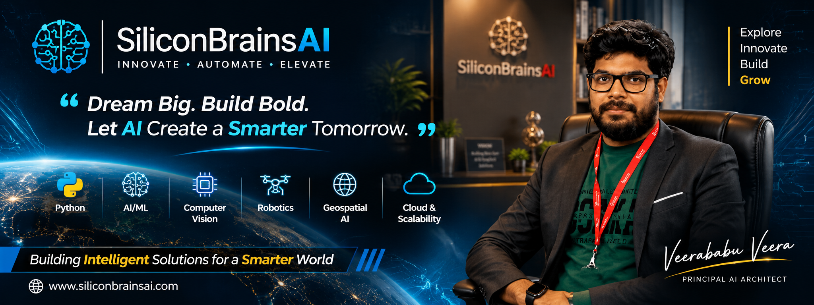

<div align="center">

<!-- 🚀 HIGH-IMPACT ENTERPRISE BANNER -->


<br>

# ⚡ Veera Babu Veera
### 🚀 Founder & Principal AI Architect, SiliconBrainsAI | Autonomous Systems & Defense AI Architect


<br><br>

[](https://www.siliconbrainsai.com)
[](mailto:siliconbrainsai@gmail.com)
[](https://github.com/siliconbrainsai)

<br>

> 💡 *"Dream Big. Build Bold. Let AI Create a Smarter Tomorrow."*

</div>

---

## 🌍 Engineering Vision

Building sovereign, high-concurrency intelligent platforms for defense, aerospace, and edge ecosystems:

- 🐍 **Python & Advanced AI/ML:** Physics-Informed Neural Networks (PINNs) & Edge LLMs
- 👁️ **Computer Vision:** Real-Time Object Tracking & Visual Odometry
- 🤖 **Robotics & Swarms:** Multi-UAV Swarm Intelligence & C4ISR Maritime Systems
- 🌐 **Geospatial AI & Digital Twins:** 3D Volumetric Photogrammetry & Bathymetric Engines
- ⚡ **High-Performance Architecture:** C++/CUDA Acceleration, FastAPI & WebGL

---

## 🧠 About Me

- 🔹 **Founder & CEO / Principal AI Architect** at **SiliconBrainsAI**
- 🔹 **Active Researcher** engineering intelligence frameworks for space & defense missions
- 🔹 **Specialist in Edge AI Deployment:** Ollama, Llama, Azure OpenAI, Claude API & CUDA Acceleration
- 🔹 **Architecture Focus:** Microservice backends (FastAPI), interactive web visualizers (Streamlit, React, Three.js)
- 🔹 **Algorithmic Acceleration:** Integrating Vedic mathematics into computational acceleration models
- 🔹 **Languages:** English & Telugu (తెలుగు)

---

## 🚀 Currently Building

<table>
  <tr>
    <td width="50%">
      <h3>🛸 GARUDA-NETRA AI / GARUDA-AVOID</h3>
      <p>Autonomous UAV logistics & real-time obstacle avoidance platform using PINNs, Visual Odometry, and Post-Quantum Cryptography.</p>
    </td>
    <td width="50%">
      <h3>🐟 AQUA-SENTINEL-X</h3>
      <p>Subsurface biomimetic robotic fish swarm & 3D bathymetric C4ISR defense platform for maritime border surveillance.</p>
    </td>
  </tr>
  <tr>
    <td width="50%">
      <h3>🚁 AEROTWIN</h3>
      <p>End-to-end eVTOL digital twin ecosystem for airspace safety, compliance monitoring, and structural anomaly detection.</p>
    </td>
    <td width="50%">
      <h3>🌌 SPACEHAB-TWIN AI (AETHEL-3)</h3>
      <p>PINN volumetric digital twin for deep space inflatable habitat breach detection and fluid dynamics modeling.</p>
    </td>
  </tr>
  <tr>
    <td width="50%">
      <h3>🌖 VISHVAKARMA-X / LUNAR CARGO</h3>
      <p>Lunar lander hazard avoidance and logistics digital twin utilizing mmWave radar fusion and ballistic capture solvers.</p>
    </td>
    <td width="50%">
      <h3>🏢 ELEVATEGUARD AI</h3>
      <p>Autonomous 72-hour predictive maintenance platform for industrial elevator networks adhering to ISO/EN standards.</p>
    </td>
  </tr>
</table>

---

## 🔬 Areas of Expertise

```text
Autonomous Systems & Defense
├── Multi-UAV Swarms & Swarm Intelligence
├── Physics-Informed Neural Networks (PINNs)
├── Visual Odometry & Obstacle Avoidance
├── Subsurface Biomimetic Robotics (C4ISR)
└── Space Situational Awareness & Debris Tracking

Backend & Distributed Systems
├── FastAPI Microservices
├── System Architecture & Distributed Systems
├── Real-Time WebSockets & Telemetry Streaming
└── High-Concurrency REST APIs

Edge AI & Computer Vision
├── Real-Time Object Tracking & Detection
├── PyTorch, OpenCV, CUDA & TensorRT Integration
├── Edge LLMs (Ollama / Local Inference)
└── 3D Point Cloud Photogrammetry

Data & Cloud Engineering
├── Digital Twin Engineering (WebGL / Three.js)
├── ETL & Telemetry Processing Pipelines
├── Azure Cloud & Docker Containerization
└── Post-Quantum Key Distribution & Cryptography
